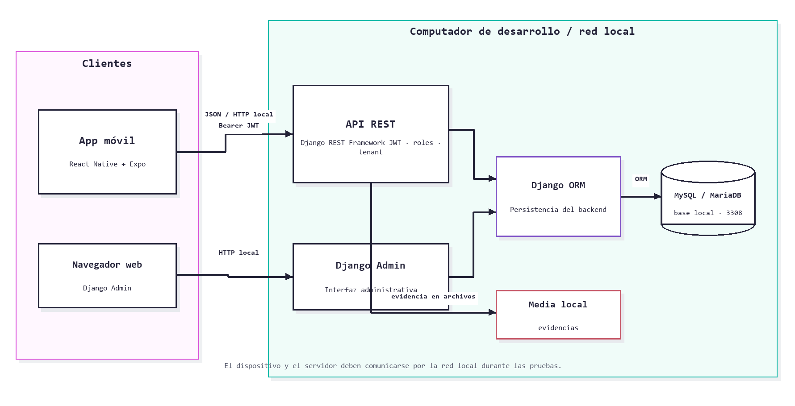
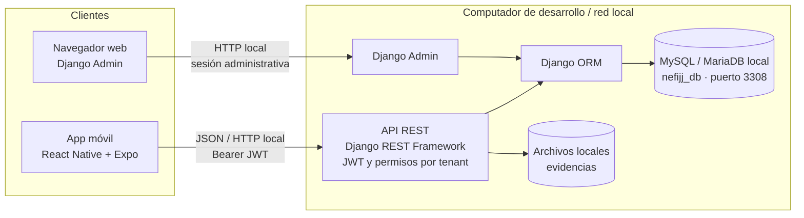
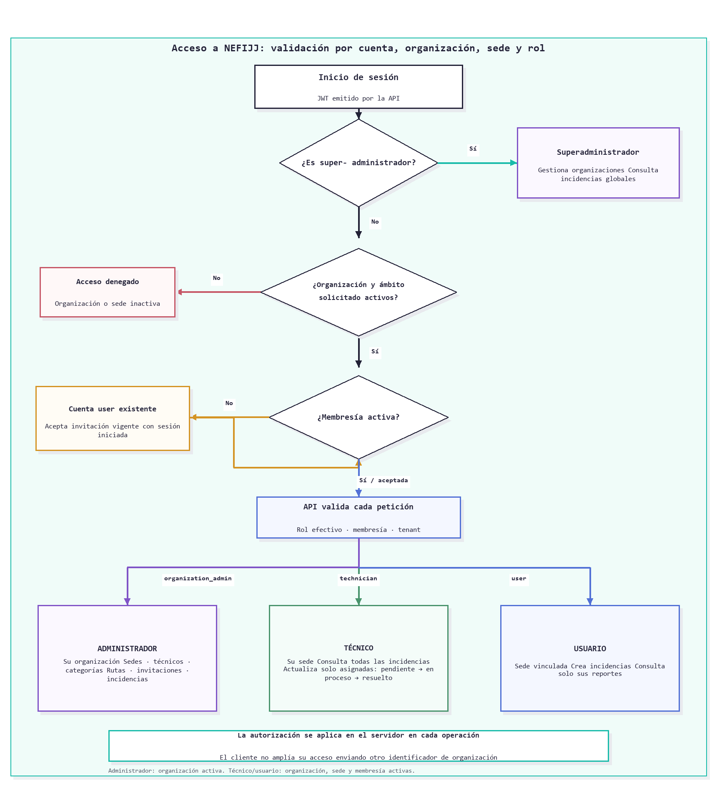
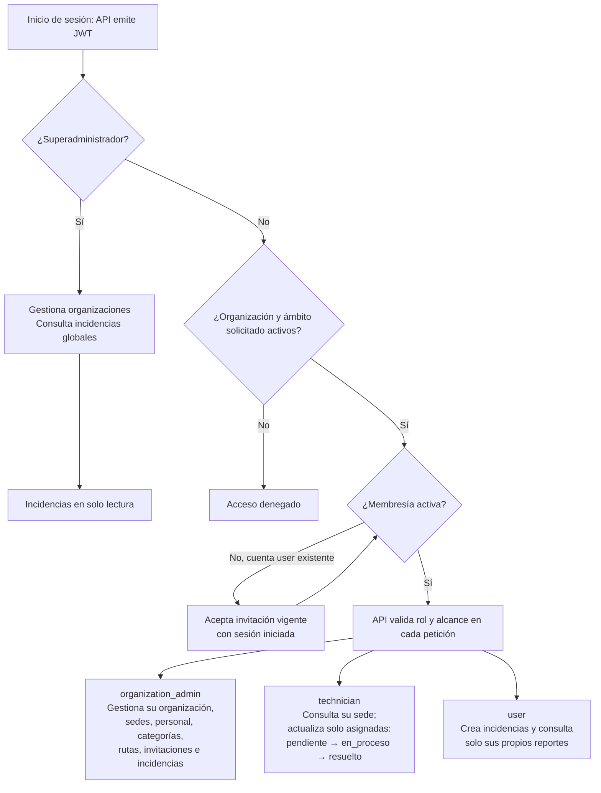
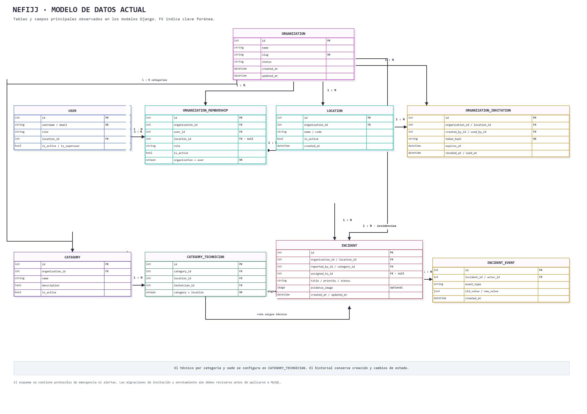
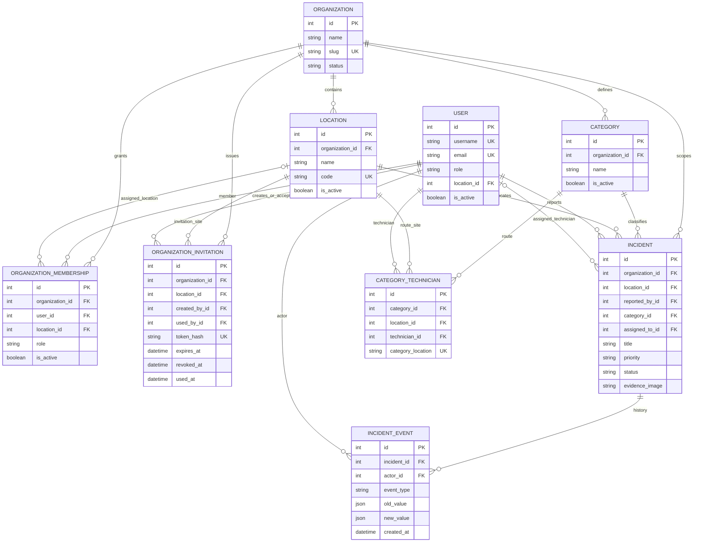

# Diagramas del sistema — NEFIJJ 3.0

Los siguientes diagramas se rediseñaron tomando como referencia visual los ejemplos suministrados: arquitectura cliente-servidor, flujo de autorización y modelo relacional. El contenido se contrastó con el código actual. No se agregan entidades ni funciones que el proyecto no tenga; en particular, protocolos de emergencia y alertas no forman parte del modelo actual.

## 1. Arquitectura local

[Abrir imagen PNG de arquitectura](diagramas_png/01_arquitectura.png)

El navegador representa el sitio de administración Django que existe en `/admin/`. La interfaz principal para los roles de la institución es la aplicación móvil. El backend usa Django ORM para persistir en MySQL/MariaDB local. Las evidencias se guardan como archivos y se consultan por la API autenticada.

## 2. Validación de acceso y flujo por rol

[Abrir imagen PNG del flujo de autorización](diagramas_png/02_flujo_roles.png)

La autorización se aplica en cada operación del servidor. Un estudiante con cuenta existente y sin membresía puede iniciar sesión y aceptar una invitación válida; una cuenta de soporte no se vincula mediante ese flujo. Para administradores se valida la organización; para técnicos y usuarios también se comprueba la sede y membresía activa correspondiente. El superadministrador puede administrar organizaciones y consultar incidencias globales, pero no efectuar cambios operativos sobre incidencias.

## 3. Modelo relacional actual

[Abrir imagen PNG del modelo relacional](diagramas_png/03_modelo_datos.png)

El diagrama resume las entidades existentes en los modelos Django: organizaciones, sedes, usuarios, membresías, invitaciones, categorías, rutas de técnico, incidencias e historial de eventos. `PK` es clave primaria, `FK` clave foránea y `UK` campo o combinación única. Los campos agrupados son una síntesis visual, no el esquema SQL completo.

### Nota sobre las migraciones

Las entidades de invitación y enrutamiento están definidas en el código, pero sus migraciones siguen pendientes de revisión antes de aplicarse a la base MySQL local con esquema legado. El diagrama representa el modelo Django, no confirma que todas las tablas existan actualmente en esa base.
